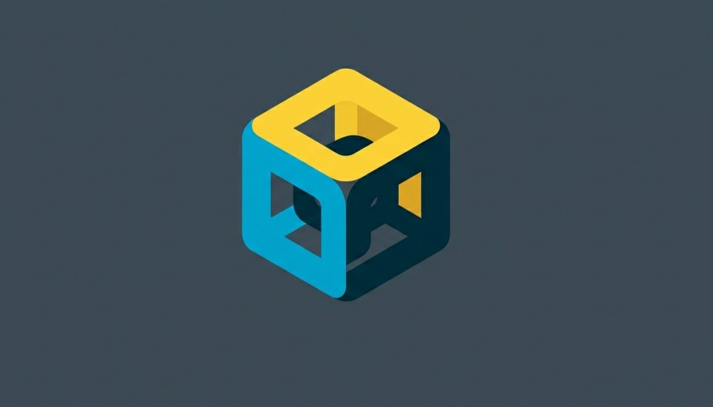

# PyGo

[](https://github.com)
[](https://github.com)
[](go/)
[](python/)
[](cpp/)

**PyGo** is a hybrid deep-learning framework designed with **Go as the top-level application API**, **Python** for autograd and model ecosystems, and **C++ / CUDA** for native tensor storage and high-performance compute.

Instead of running Python as a separate sidecar process, PyGo embeds CPython directly inside the Go host process. All language layers share a unified native tensor runtime—allowing Go, Python, and C++/CUDA to exchange tensor handles and buffers without serialization overhead or inter-process boundaries.

---

## Key Features

- **Go-First Orchestration:** Build production training loops, inference pipelines, and serving infrastructure directly in Go.
- **In-Process Embedded CPython:** Tap into Python’s autograd engine, model zoo, and callbacks without IPC latency.
- **Zero-Copy Native Tensor Memory:** Storage and metadata live in the C++ runtime with explicit ownership contracts separating copying constructors from external-buffer APIs.
- **Hardware-Accelerated Kernels:** Native C++ operator dispatch backed by CPU (AVX-512) and optional NVIDIA CUDA kernels.

---

## Architecture

```text
Go API                  ── Public API, orchestration & serving
   │
   ▼
CGo / Stable C ABI      ── Language-agnostic native boundary
   │
   ▼
Embedded CPython        ── In-process Python runtime
   │
   ▼
pybind11                ── Native C++ ↔ Python bindings
   │
   ▼
C++ Native Runtime      ── Tensor memory, operators & dispatch
   ├── CPU / AVX-512
   └── CUDA
```

### Layer Responsibilities

| Layer | Responsibility |
| :--- | :--- |
| **Go** | Public API, application integration, training/inference orchestration, and serving |
| **CGo / C ABI** | Stable ABI boundary between Go and the native runtime |
| **Embedded CPython** | In-process execution of the Python ML ecosystem |
| **Python** | Autograd integration, model zoo, high-level utilities, and callbacks |
| **pybind11** | Seamless C++ ↔ Python interoperability |
| **C++** | Core tensor runtime, memory management, operators, and dispatch |
| **CUDA / AVX-512** | Hardware-specific compute kernels |

### Tensor Memory Model

```text
          ┌───────────────────────┐
          │     Native Tensor     │
          │  metadata + storage   │
          └───────────┬───────────┘
                      │
          ┌───────────┼───────────┐
          ▼           ▼           ▼
        Go API      Python      C++/CUDA
```

Zero-copy access across boundaries is enforced through explicit storage lifetime and ownership guarantees, distinguishing standard copying constructors from external-buffer APIs.

---

## Getting Started

### Prerequisites

- **C++ Compiler** with C++17+ support & **CMake**
- **Go** (1.21+ recommended)
- **Python 3** (with development headers for embedded CPython)
- **NVIDIA CUDA Toolkit** *(optional, for GPU acceleration)*

### 1. Build the Native C++ Runtime (CPU)

```bash
git clone https://github.com/Sarkar-Labs/pygo.git
cd pygo

cmake -S . -B build \
  -DCMAKE_BUILD_TYPE=Release \
  -DPYGO_ENABLE_CUDA=OFF \
  -DPYGO_BUILD_SHARED=ON \
  -DPYGO_BUILD_TESTS=ON

cmake --build build --parallel
ctest --test-dir build --output-on-failure
```

### 2. Install the Python Package

```bash
python -m pip install pygo-python -e .
python -m pytest tests/python -q
```

### 3. Build & Test the Go API

Ensure the compiled native shared library (`build/`) is discoverable by your system linker/runtime loader (e.g., via `LD_LIBRARY_PATH` on Linux or `DYLD_LIBRARY_PATH` on macOS) before running Go tests:

```bash
go test ./...
```

---

## Building with CUDA Support

CUDA support is optional in `0.1.0`. On a CUDA-capable machine, configure and build the native runtime with `-DPYGO_ENABLE_CUDA=ON`:

```bash
cmake -S . -B build-cuda \
  -DCMAKE_BUILD_TYPE=Release \
  -DPYGO_ENABLE_CUDA=ON \
  -DPYGO_BUILD_SHARED=ON \
  -DPYGO_BUILD_TESTS=ON

cmake --build build-cuda --parallel
ctest --test-dir build-cuda --output-on-failure
```

> **Note:** Hardware validation for CUDA runs via a dedicated GitHub Actions workflow on self-hosted NVIDIA runners rather than standard GitHub-hosted CPU runners.

---

## Repository Layout

```text
pygo/
├── go/                 # Go public API and Go ecosystem
├── python/             # Python autograd and model ecosystem
├── cpp/                # C++ runtime, CPU/AVX-512, and CUDA kernels
├── bindings/           # CGo, CFFI, pybind11, and SWIG binding sources
├── bridge/             # Cross-language bridge logic
├── docs/               # Architecture, guides, and API documentation
├── tests/              # Cross-language and integration tests
├── .github/workflows/  # CI, CUDA validation, and release automation
├── CMakeLists.txt
├── go.mod
├── pyproject.toml
├── pygo.jpg
└── VERSION
```

---

## Release Status (`v0.1.0`)

**PyGo 0.1.0** is the initial release line. The project strictly separates implemented source code from target-specific hardware validation. Optional components—including **CUDA**, **AVX-512**, and **embedded CPython**—should only be considered supported on a given platform after passing their respective build and runtime test suites on that target.

---

## Documentation

- [System Architecture](docs/architecture/ARCHITECTURE.md)
- [Embedded CPython Design](docs/architecture/EMBEDDED_CPYTHON.md)
- [Installation Guide](docs/guides/installation.md)
- [Quickstart Guide](docs/guides/quickstart.md)
- [Release Notes (v0.1.0)](docs/RELEASE_0.1.0.md)
- [Changelog](CHANGELOG.md)

---

## Contributing

Contributions are welcome! Please review the architecture documentation before submitting pull requests, and ensure all C++, Python, and Go test suites pass locally.

## License

PyGo is released under the **MIT License**. See [LICENSE](LICENSE) for full details.
